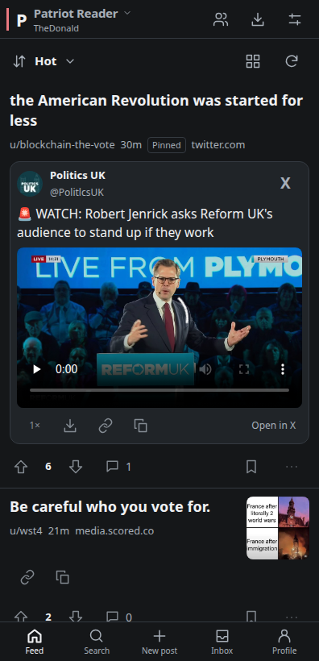

# Patriot Reader

An Android reader for patriots.win and scored.co, built for a cleaner, more comfortable mobile experience. Browse the front page without signing in, or use your existing account to post, comment, vote, and set post flair.

I made this for my own use so I could stop using Firefox to browse patriots.win and get embedded videos working the way I wanted. **Use at your own risk!**

## Features

- **The Donald and Scored communities** — use the title dropdown to switch feeds with your existing account. Community names open their feeds, and new Scored posts have a community selector.
- **Dark by default** — also supports light mode and your Android system theme.
- **Readable post flair** — see flair on posts and choose it when creating a post on mobile.
- **YouTube, X, and Rumble embeds** — supported videos play inside the reader. Open in X takes you directly to the installed X app, with an in-app browser fallback.
- **Truth Social posts** — public post text, images and supported video/audio appear in reader cards, with a link to the original when a post is unavailable or restricted.
- **Compact browsing** — automatic feed and reply loading, direct access to comments, and collapsible reply threads with compact, connected thread lines. Comments support direct video/audio links, Unicode emojis, and clickable HTTPS URLs.
- **Media controls** — pinch-to-zoom, double-tap and drag on images, playback speed for direct videos, and remembered volume for direct/X videos and YouTube.
- **Copy links** — copy the original source URL or the Patriots/Scored discussion link from compact preview controls.
- **Discussion and profile tools** — comment sorting, inline reply expansion, Top-post time ranges, public profiles and comment history, and pull-to-refresh.
- **Inbox and safety tools** — paged inbox folders, conversations and replies, comment permalinks, reporting, and user blocking. Read markers stay on your device.
- **Save for later** — bookmark posts on your device, sync saves to website folders with retry for failed syncs, download supported media, and cache posts and images for repeat viewing.
- **View your downloads** — preview saved images, video and audio directly in the list, zoom pictures, share files, or copy a supported image to paste into another app.

## Screenshots

X video playback and the mobile post-flair picker. Captured from the app's browser preview.

  
  

## Install

Requires **Android 10 or newer** and an up-to-date Android System WebView.

Download `PatriotReader-<version>.apk` from this repository's **Releases** and install it on your phone. Open the app to browse; sign in through Profile when you want to participate.

Early development. Not affiliated with patriots.win.

No open-source license has been granted for this project.
