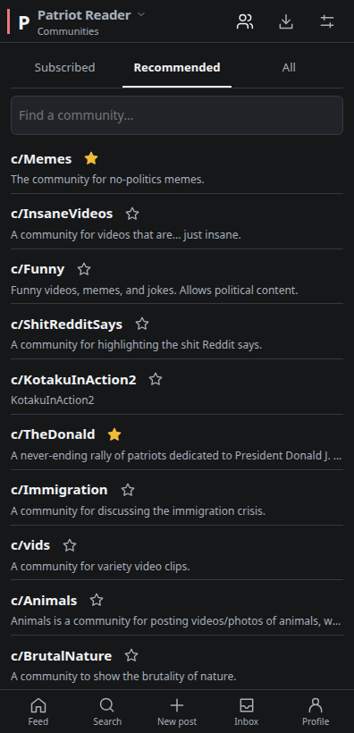
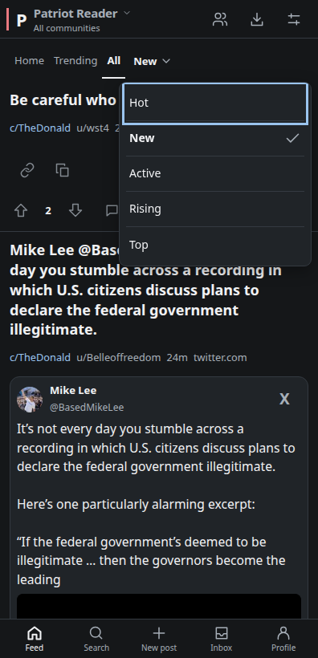

# Patriot Reader

An Android reader for patriots.win and scored.co, built for a cleaner, more comfortable mobile experience. Browse the front page without signing in, or use your existing account to post, comment, vote, and set post flair.

I made this for my own use so I could stop using Firefox to browse patriots.win and get embedded videos working the way I wanted. **Use at your own risk!**

## Features

- **Patriots.win and all Scored.co communities** — use the title dropdown to switch between The Donald and Scored.co with your existing account. Open individual community feeds and choose a community when posting.
- **Find and follow communities** — browse Subscribed, Recommended, or All, search for communities, and tap the stars to subscribe or unsubscribe.
- **Home, Trending, and All feeds** — Home shows your subscribed communities. Switch feeds, sort by Hot, New, Active, Rising, or Top, and choose a time range for Top posts. Pinned posts stay at the top when switching feeds or sorting, with visible moderator and pin markers.
- **NSFW controls** — show everything by default, or blur previews and tap to reveal, or hide posts marked NSFW by the site.
- **Dark by default** — also supports light mode and your Android system theme.
- **Readable post flair** — see flair on posts and choose it when creating a post on mobile.
- **YouTube, X, and Rumble embeds** — supported videos play inside the reader. Open in X takes you directly to the installed X app, with an in-app browser fallback.
- **Truth Social posts** — public post text, images and supported video/audio appear in reader cards, with a link to the original when a post is unavailable or restricted.
- **Compact browsing** — automatic feed and reply loading, direct access to comments, and collapsible reply threads with compact, connected thread lines. Comments support direct video/audio links, Unicode emojis, and clickable HTTPS URLs.
- **Media controls** — page-wide pinch-to-zoom, including image popups; image Zoom/Fit controls and dragging; playback speed for direct videos; and remembered volume for direct/X videos and YouTube.
- **Copy links** — copy the original source URL or the Patriots/Scored discussion link from compact preview controls.
- **Discussion and profile tools** — comment sorting, inline reply expansion, Top-post time ranges, public profiles and comment history, and pull-to-refresh.
- **Inbox and safety tools** — paged inbox folders, conversations and replies, comment permalinks, reporting, and user blocking. Read markers stay on your device.
- **Save for later** — bookmark posts on your device, sync saves to website folders with retry for failed syncs, download supported media, and cache posts and images for repeat viewing.
- **View your downloads** — preview saved images, video and audio directly in the list, zoom pictures, share files, or copy a supported image to paste into another app.

## Recent improvements

- Pinned posts remain visible across feed and sort changes, and Scored search works across Home, Trending, and All.
- NSFW controls offer Show everything, Blur NSFW, or Hide NSFW; Show everything is the default.
- Reply recovery preserves submitted text and newer edits after a connection failure, helping prevent duplicate comments.
- Download storage problems no longer block the front page, and progress updates avoid repeatedly reopening every saved file.

## Screenshots

Current X video controls, Recommended Scored communities, and Scored feed sorting. Captured from the app’s browser preview using public site content.

  
  
  

## Install

Requires **Android 10 or newer** and an up-to-date Android System WebView.

Download `PatriotReader-<version>.apk` from this repository's **Releases** and install it on your phone. Open the app to browse; sign in through Profile when you want to participate.

Early development. Not affiliated with patriots.win.

No open-source license has been granted for this project.
